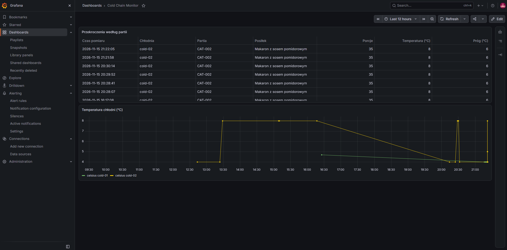

# Cold Chain Monitor

Projekt edukacyjny do monitorowania temperatury powietrza w chłodniach firmy cateringowej.

## Scenariusz

- `cold-01` przechowuje partię `CAT-001`: 40 porcji kurczaka z ryżem i warzywami.
- `cold-02` przechowuje partię `CAT-002`: 35 porcji makaronu z sosem pomidorowym.
- W symulacji temperatura w `cold-02` rośnie z 4°C do 8°C, a potem wraca do 4°C.
- Próg alertu w demo to 6°C.

## Architektura

1. Symulator wysyła pomiary przez MQTT do brokera Mosquitto.
2. n8n sprawdza wiadomości i zapisuje temperatury w InfluxDB.
3. PostgreSQL wiąże przekroczenie z partią obecną w chłodni w chwili pomiaru.
4. Grafana pokazuje wykres temperatur, alert i raport przekroczeń według partii.


## Testy przepływu danych

| Próba | Wynik |
|---|---|
| `cold-02`, 4°C | Pomiar jest widoczny w InfluxDB w buckecie `telemetry`. |
| `cold-02`, 8°C | Pomiar jest widoczny w InfluxDB. PostgreSQL zapisał przekroczenie progu 6°C dla partii `CAT-002`. |
| `cold-02`, temperatura `awaria` | n8n odrzucił wiadomość w kroku walidacji z błędem „Temperatura musi być liczbą”. |


## Demo przegrzania chłodni

1. Symulator wysyła pomiar 8°C dla `cold-02` przez MQTT.
2. n8n sprawdza wiadomość i zapisuje temperaturę w InfluxDB.
3. PostgreSQL przypisuje przekroczenie progu 6°C do partii `CAT-002`,
   obejmującej 35 porcji makaronu z sosem pomidorowym.
4. Grafana pokazuje stan **Firing**. Po wysłaniu 4°C alert wraca do
   **Normal**, a przekroczenie pozostaje w raporcie.



[Alert przy 8°C](docs/alert-firing.png) · [Powrót do normy przy 4°C](docs/alert-normal.png)


## Uruchomienie lokalne

1. W głównym folderze projektu utwórz `.env` z linią
   `POSTGRES_PASSWORD=twoje_lokalne_haslo`. Zastąp przykładową wartość własnym hasłem.
2. Uruchom `docker compose up -d` w PowerShellu. Polecenie uruchomi usługi w tle.
3. Na świeżej bazie wykonaj skrypty PostgreSQL w podanej kolejności:

   ```powershell
   $skrypty = @('01-bootstrap.sql', '02-temperature-excursions.sql', '03-grafana-reader.sql')
   foreach ($plik in $skrypty) {
       docker compose cp "./sql/$plik" "postgres:/tmp/$plik"
       if ($LASTEXITCODE -ne 0) { throw "Blad kopiowania: $plik" }

       docker compose exec -T postgres psql -U cold_chain -d cold_chain -v ON_ERROR_STOP=1 -f "/tmp/$plik"
       if ($LASTEXITCODE -ne 0) { throw "Blad wykonania: $plik" }
   }

   docker compose exec postgres psql -U cold_chain -d cold_chain -c '\password grafana_reader'
   ```

4. W **InfluxDB** (`http://localhost:18086`) utwórz organizację `catering` i bucket
   `telemetry`. Utwórz token zapisu dla n8n i token odczytu dla Grafany.
5. W **n8n** (`http://localhost:15678`) wybierz **⋯ → Import from File**
   i zaimportuj [workflow](docs/cold-chain-workflow.json). Podłącz poświadczenia
   do brokera `mosquitto:1883`, token zapisu InfluxDB w węźle HTTP Request oraz
   połączenie z bazą `cold_chain` na `postgres:5432` jako `cold_chain`.
   W Header Auth wpisz nazwę `Authorization` i wartość `Token ` z tokenem zapisu
   po spacji. Kliknij **Publish**.
6. W **Grafanie** (`http://localhost:13000`) dodaj dwa źródła danych:
   - **InfluxDB:** `http://influxdb:8086`, język Flux, organizacja `catering`,
     bucket `telemetry` i token odczytu.
   - **PostgreSQL:** `postgres:5432`, baza `cold_chain`, użytkownik `grafana_reader`
     i hasło ustawione przez `\password`.
7. W Grafanie wybierz **Dashboards → New → Import** i wczytaj
   [dashboard](docs/cold-chain-dashboard.json). Jeśli trzeba, wybierz InfluxDB
   w panelu temperatur i PostgreSQL w panelu przekroczeń.
8. W **Alerting → Alert rules** dodaj regułę dla temperatury `cold-02`.
   Wybierz ostatni pomiar z pięciu minut i warunek **powyżej 6°C**.
   Ustaw ocenę co minutę oraz **Pending period** i **Keep firing for** na **None**.
   Stan reguły podczas demo sprawdzisz w Grafanie.